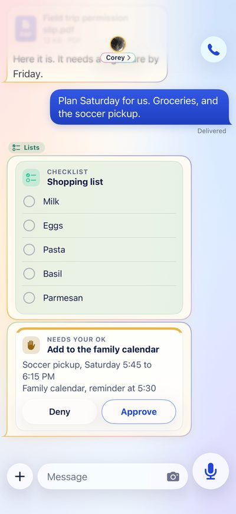
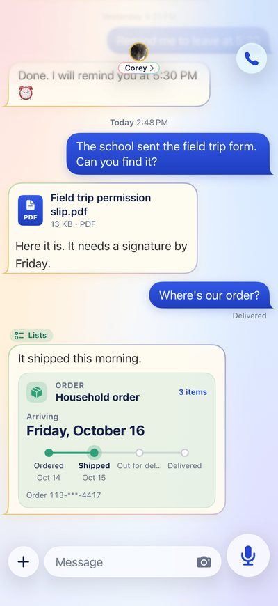
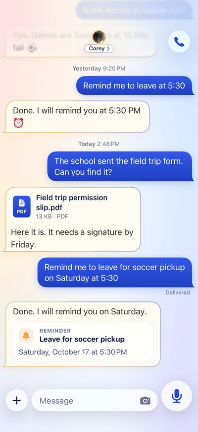
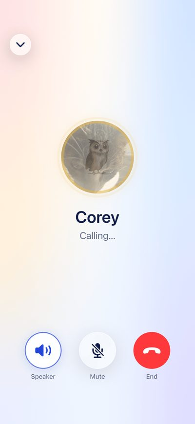
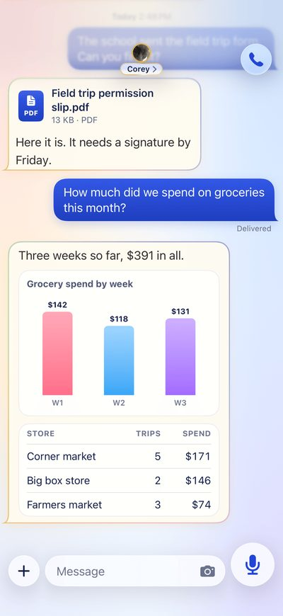
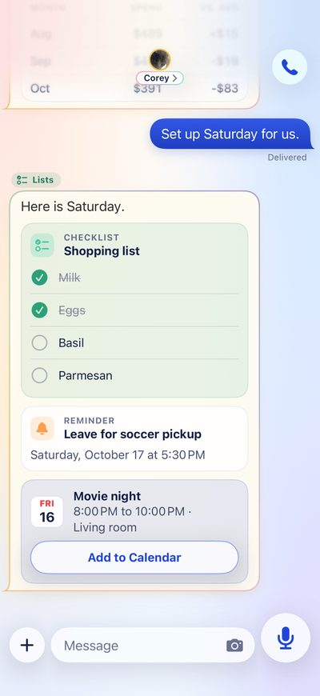
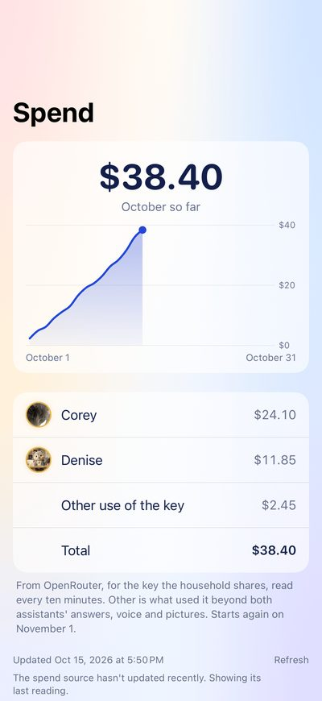
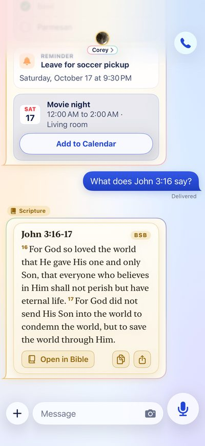

<h1 align="center">Household Assistant</h1>

<p align="center">
Two AI assistants and one iPhone app for a two-parent household.<br>
They share a family room, a note, a cart and a calendar, and they run on a small private server the household owns.
</p>

<p align="center">
  
</p>

## Meet the two assistants

**Corey** and **Denise** are two assistants, each with their own gateway and their own person.
Each person talks to their assistant in the **Steward AI** app, one private thread each, plus a **family room** that both people and both assistants share.
They are one household's helpers, so they keep one household's records: a shared note, a shared cart, a shared calendar.

<table>
  <tr>
    <td align="center" width="25%"><br><sub><b>Approvals</b><br>nothing goes out without a tap</sub></td>
    <td align="center" width="25%"><br><sub><b>Orders</b><br>from the shared cart to the door</sub></td>
    <td align="center" width="25%"><br><sub><b>Reminders</b><br>set by a word or a voice note</sub></td>
    <td align="center" width="25%"><br><sub><b>Voice calls</b><br>talk to it like a person</sub></td>
  </tr>
</table>

Everything in the pictures is made-up demo data, drawn by the app's own screenshot tests.

## What they do

| | |
|---|---|
| **Today card** | The next things on the calendar and a verse for the day, written at 4:45 and 16:45. |
| **Prep packets** | Each morning at 8:00, one packet per event 36 to 60 hours away: address, when to leave, what to bring, forms, confirmation number. |
| **Sunday digest** | Sunday at 19:00: the week at a glance, what is slipping, the cart, open promises and what needs a decision. |
| **The household note** | One shared record both assistants write: logs with a row per item, due days, promises, reminders, handoffs. |
| **Cart** | One shared shopping list. An order is one tap, then Amazon's checkout with the cart filled in. |
| **Meal plan** | Up to seven dinners from what is in the kitchen and what is on sale. After a yes, the missing items go in the cart, each once. |
| **Document vault** | Send a photo of a passport, policy or warranty. The assistant keeps its renewal day and tells its owner 30 days ahead. |
| **Wishlist** | Quietly remembers what people say they want. Hands the ideas to the right parent three weeks before a birthday or Christmas. |
| **Emergency card** | `/emergency` answers at once, with no model: vet, poison control, pediatrician, insurance, neighbor. |
| **Photo keeper** | On the phone only: last month's best shots and a short video, and a clean-out of near-duplicates, blurry shots and old screenshots. |
| **The house** | Thermostat, TV volume, Spotify, YouTube and the TV's power, through a key holder that limits what they can do. |
| **Finances** | Each person's assistant reads that person's PocketPiggies account, read-only, after their consent. |
| **Spend** | What each assistant cost this month, rebuilt every ten minutes. |
| **Voice** | Voice notes, voice calls and spoken replies, with ceilings on what speech may cost. |
| **Pictures and video** | Made on request, with a daily dollar ceiling for each person. |
| **Everything else** | Charts, checklists, scripture cards, maps, reminders, calendars and mail, widgets, the Share Sheet and a Talk button. |

<table>
  <tr>
    <td align="center" width="25%"><br><sub><b>Charts</b></sub></td>
    <td align="center" width="25%"><br><sub><b>Checklists</b></sub></td>
    <td align="center" width="25%"><br><sub><b>Spend</b></sub></td>
    <td align="center" width="25%"><br><sub><b>Scripture</b></sub></td>
  </tr>
</table>

## How a message travels

<p align="center">
  
</p>

A message in a person's own thread starts a turn only if one of that person's phones signed it.
Neither an assistant nor anyone holding a gateway token can speak for them.

## Working together

<p align="center">
  
</p>

The note is the one place family facts live.
A weigh-in, a due date or a promise made to one assistant is there for the other, and for the next turn of either.

## Nothing is sent without a tap

<p align="center">
  
</p>

Email send is off until a gateway is given an account for it.
Until then only a cart order can be sent, and its tap opens Amazon's checkout, where the person pays.

## When things happen

<p align="center">
  
</p>

Times are in the household's own time zone.

## Phase 1 - identity and privacy spine

These rules do not bend.

- **Identity comes from the channel, never from the text.** A display name, a message body or a model-supplied id is ignored on purpose, and the default is to refuse.
- **Private stays private.** A group route never carries a private scope, or a tool that reaches one person's mail, calendar or approvals.
- **A tool cannot name who it acts for.** The actor and the scopes come from the signed envelope, and a delegate can only narrow it.
- **A yes is not a tool.** An approval binds one action, actor, route, destination and expiry, and it is spent once.
- **Keys stay out of the assistants.** The house and the finance accounts sit behind key holders on the host, which answer with what the house read back and never with the token.
- **Memory has a budget.** Every container declares a memory limit, so a runaway assistant cannot starve the rest of the box.

The Python service in [household/](household) is where these rules are written and tested, against mocked providers, with no credential from anyone.
The deployed gateways follow the owner-authorized exception in [the family group](docs/deploy/openclaw.md#the-family-group).

## How it runs

- **One small private server** runs both gateways as OpenClaw containers, behind the household's private network.
  Models come through OpenRouter, and each owner can choose fallback models in Settings.
- **The app is the channel.** Telegram is retired, and nothing on the gateways reads it any more.
- **A relay on the host** carries the family room between the gateways, every message signed by the phone that sent it.
- **Key holders** answer for the house and for PocketPiggies over a local socket.
- **Backups** run every night: both gateways' state, then a restore drill that opens what it just wrote.
- **Rollouts** go one gateway at a time, each after a backup of its state.

## How the app is built

There is no Mac of our own.
GitHub lends one for a job and wipes it afterwards, and its minutes are free while this repository is public.
Linux checks run on every pull request.
A Mac run starts only by hand, stops at a timeout, and reports what it cost.
A TestFlight release is one click, from main.

## Where things are

| Folder | What is in it |
|---|---|
| [apps/ios/](apps/ios) | The Steward AI app, as a text XcodeGen spec ([its README](apps/ios/README.md)) |
| [deploy/openclaw/plugins/](deploy/openclaw/plugins) | The OpenClaw plugins: the app's channel and family room, memory, pictures, scripture, PocketPiggies |
| [deploy/openclaw/skills/](deploy/openclaw/skills) | The skills both assistants get |
| [household/](household) | The identity and privacy spine, the home and PocketPiggies key holders |
| [scripts/](scripts) | The installers, relay, backup and checks, run as root on the box |
| [services/voicebox/](services/voicebox) | A local speech service that waits for a Mac to run on |
| [docs/](docs) | Runbooks, plans and the Apple checklist |

## Read more

- [OpenClaw on the server](docs/deploy/openclaw.md): reach it, restart it, back it up, roll it back, and how the family room works
- [PocketPiggies](docs/deploy/pocket-piggies.md): who can read finance, and how
- [Retiring SIQsermon](docs/deploy/siqsermon-retirement.md): scripture in the gateways, and SIQsermon's containers stopped
- [Retiring Telegram](docs/deploy/retiring-telegram.md): taking out what Telegram left, one gateway at a time
- [PocketPiggies' server](docs/deploy/pocketpiggies-server.md): what it needs for linking from the app
- [Apple activation checklist](docs/apple-activation-checklist.md): everything only the owner can do, in order
- [TestFlight](docs/testflight.md) and [Apple signing](docs/apple-signing.md)
- [Phase 0 headroom](docs/phase0/runbook.md) and [the memory budget](docs/phase0/budget.md)
- [Plans and briefs](docs/plan/README.md)

## Run the checks

```
python -m venv .venv
.venv/Scripts/python.exe -m pip install -e ".[dev]"
.venv/Scripts/python.exe -m ruff format --check .
.venv/Scripts/python.exe -m ruff check .
.venv/Scripts/python.exe -m mypy
.venv/Scripts/python.exe -m pytest
```
